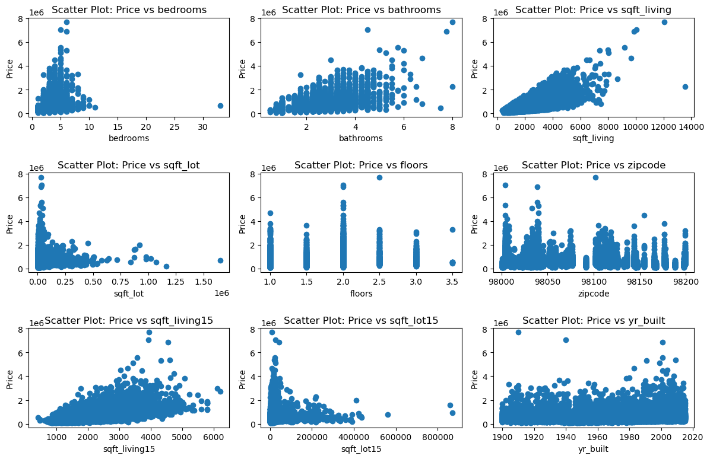
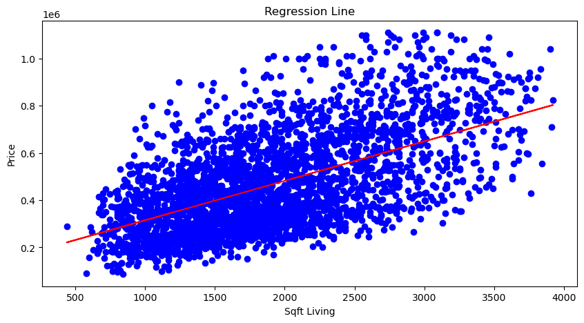
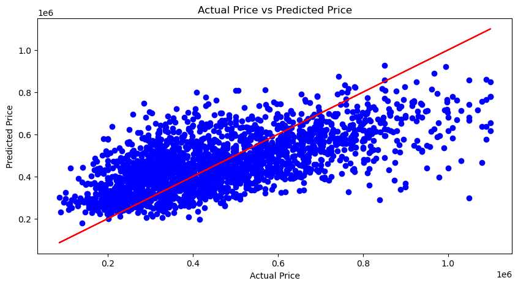

# Northwest County Housing Analysis 🏠

[](https://www.python.org/)
[](https://jupyter.org/)


## 📋 Table of Contents
- [Project Overview](#project-overview)
- [Business Problem](#business-problem)
- [Dataset](#dataset)
- [Methodology](#methodology)
- [Key Findings](#key-findings)
- [Model Performance](#model-performance)
- [Technologies Used](#technologies-used)
- [Project Structure](#project-structure)
- [Installation & Usage](#installation--usage)
- [Visualizations](#visualizations)
- [Team](#team)
- [Contributing](#contributing)
- [License](#license)

## 🎯 Project Overview

This project provides a comprehensive analysis of the real estate market in King County, Washington, using machine learning techniques to predict house prices. Our team developed multiple linear regression models to help real estate agencies, homebuyers, and property developers make informed decisions in a volatile market.

**Duration**: 4 weeks  
**Team Size**: 5 members  
**Role**: Team Lead  

## 🏗️ Business Problem

The fluctuating real estate market in Northwestern counties creates uncertainty for multiple stakeholders:

- **Real Estate Agents**: Difficulty in property valuation and pricing strategies
- **Homebuyers**: Uncertainty in making informed purchasing decisions
- **Homeowners**: Challenges in timing property sales for maximum ROI
- **Property Developers**: Difficulty assessing project viability due to market volatility

### 💡 Proposed Solution
Develop a comprehensive linear regression model using historical data to predict house prices and identify key factors influencing property values, enabling stakeholders to make data-driven decisions.

## 📊 Dataset

**Source**: King County House Sales Dataset  
**Time Period**: May 2014 - May 2015  
**Records**: 21,597 house sales  
**Features**: 21 variables including price, location, property characteristics  

### Key Variables:
- **Target Variable**: `price` (Sale price)
- **Predictors**: bedrooms, bathrooms, sqft_living, sqft_lot, floors, waterfront, view, condition, grade, and more
- **Data Quality**: Cleaned dataset with 19,221 records after handling missing values

## 🔬 Methodology

### Data Science Pipeline:
1. **Data Understanding & Exploration**
   - Comprehensive EDA with univariate and bivariate analysis
   - Correlation analysis and feature selection
   - Outlier detection and treatment

2. **Data Preprocessing**
   - Missing value imputation
   - Feature engineering (build_age calculation)
   - Categorical variable encoding
   - Data normalization

3. **Model Development**
   - Simple Linear Regression (baseline)
   - Multiple Linear Regression with numeric features
   - Multiple Linear Regression with all features
   - Feature selection using statistical significance (p < 0.05)

4. **Model Evaluation**
   - R-squared and Adjusted R-squared
   - Root Mean Squared Error (RMSE)
   - Statistical significance testing
   - Cross-validation

## 🔍 Key Findings

### Significant Price Predictors:
- **Living Space** (`sqft_living`): +$203.41 per sq ft
- **Bathrooms**: +$39,380 per additional bathroom
- **Floors**: +$35,680 per additional floor
- **Property Age** (`build_age`): +$2,406 per year newer
- **Bedrooms**: -$34,980 per additional bedroom (counterintuitive finding)
- **Lot Size** (`sqft_lot`): -$5.59 per sq ft (diminishing returns)

### Market Insights:
- Living space is the strongest predictor of house price
- Property condition and grade significantly impact valuation
- Waterfront properties command premium prices
- Newer properties generally have higher values

## 📈 Model Performance

| Model | R² | Adj. R² | RMSE | Key Features |
|-------|----|---------|----- |-------------|
| Simple Linear Regression | 0.322 | 0.322 | $163,990 | sqft_living only |
| Multiple Regression (Numeric) | 0.423 | 0.423 | $150,557 | All numeric features |
| Multiple Regression (All Features) | 0.432 | 0.431 | $152,354 | All features |
| **Final Model (Feature Selected)** | **0.431** | **0.431** | **$152,269** | **6 significant features** |

**Best Model**: Feature-selected multiple linear regression explaining **43.1%** of price variance with an average prediction error of **$152,269**.

## 🛠️ Technologies Used

- **Programming**: Python 3.7+
- **Data Analysis**: Pandas, NumPy
- **Machine Learning**: Scikit-learn, Statsmodels
- **Visualization**: Matplotlib, Seaborn
- **Development Environment**: Jupyter Notebook
- **Version Control**: Git
- **Project Management**: Trello

## 📁 Project Structure

```
Northwest-County-Housing-Analysis/
├── README.md
├── student.ipynb                    # Main analysis notebook
├── project_functions.py             # Custom utility functions
├── data/
│   ├── kc_house_data.csv           # Raw dataset
│   └── column_names.md             # Data dictionary
├── Visualization*.png              # Analysis charts and plots
├── image*.png                      # Key visualizations for README
├── Northwest county housing analysis Powerpoint presentation.pdf
├── CONTRIBUTING.md
└── LICENSE.md
```

## ⚡ Installation & Usage

### Prerequisites
```bash
Python 3.7+
Jupyter Notebook
```

### Setup
```bash
# Clone the repository
git clone https://github.com/your-username/Northwest-County-Housing-Analysis.git
cd Northwest-County-Housing-Analysis

# Install required packages
pip install pandas numpy matplotlib seaborn scikit-learn statsmodels jupyter

# Launch Jupyter Notebook
jupyter notebook student.ipynb
```

## 📊 Visualizations

### 1. Feature Correlation Analysis

*Correlation matrix showing relationships between house features and prices*

### 2. Price vs. Living Space Regression

*Linear relationship between living space and house prices*

### 3. Model Performance Validation

*Final model performance showing predicted vs. actual prices*

## 👥 Team

**Team Lead**: Innocent Mbuvi  
**Team Members**:
- Joyce Njeri
- Kenneth Kipkirui  
- Brian Bett
- Innocent Mbuvi
- Michelle Nyaanga

**Instructor**: Nikita Njoroge

**Project Management**: [Trello Board](https://trello.com/b/JTac8Mqq/phase-2-group-project)

## 🚀 Future Improvements

1. **Address Multicollinearity**: Implement Ridge/Lasso regularization
2. **Feature Engineering**: Explore polynomial features and interactions
3. **Advanced Models**: Test Random Forest, Gradient Boosting
4. **Time Series Analysis**: Incorporate seasonal trends
5. **External Data**: Include economic indicators, school ratings

## 📈 Business Impact

- **Accuracy**: Models achieve 43.1% variance explanation in house prices
- **Cost Savings**: Reduced prediction error by ~7% through feature selection
- **Decision Support**: Quantified impact of each property feature on pricing
- **Scalability**: Framework can be adapted to other real estate markets


---

*This project was completed as part of a data science program, demonstrating practical application of machine learning techniques to real-world business problems.*